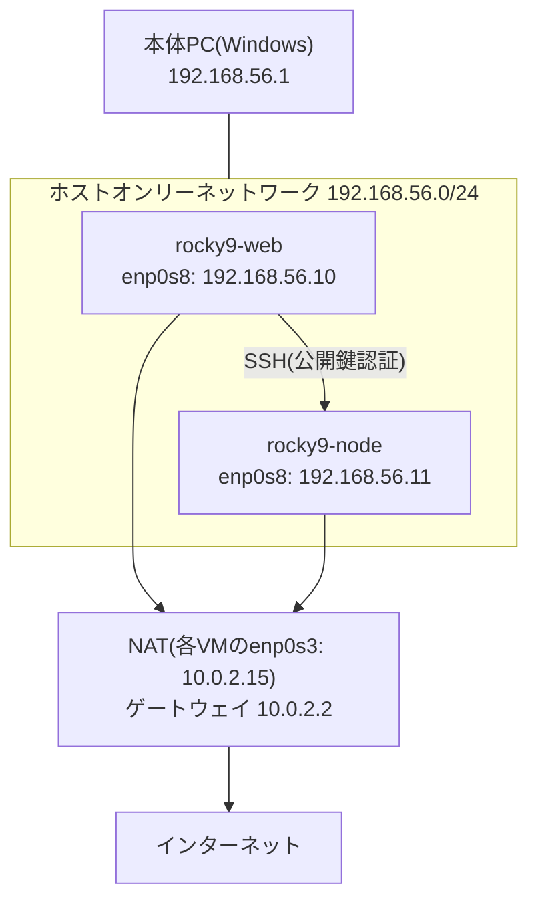

# Step 5:ネットワーク

サーバーのネットワーク設定の確認・変更から、通信の観察、2台構成、ファイアウォールの見直しまでを行う。

- A. NetworkManagerによるネットワーク設定の確認と変更
- B. tcpdumpによる通信の観察
- C. 仮想マシン2台構成
- D. firewalldの見直し(予定)

## A. NetworkManagerによるネットワーク設定の確認と変更

### 現在の構成

```
VirtualBox NATネットワーク(10.0.2.0/24)
  rocky9-web(enp0s3:10.0.2.15/24)
     │
     ▼
  VirtualBoxの仮想ルーター(ゲートウェイ 10.0.2.2)
     │
     ▼
  本体PC(DNSは本体PCと同じ 192.168.3.1)→ インターネット

本体PCからの接続:ポートフォワーディング(127.0.0.1:2222 → 22、127.0.0.1:8080 → 80)
```

### 確認した内容

| 項目 | 値 | 確認したコマンド |
|---|---|---|
| IPアドレス | 10.0.2.15/24 | `ip -br address` |
| デフォルトゲートウェイ | 10.0.2.2 | `ip route` |
| DNSサーバー | 192.168.3.1(本体PCのDNSをVirtualBoxが引き渡し) | `cat /etc/resolv.conf` |
| 取得方法 | DHCP(ipv4.method: auto) | `nmcli -f ipv4 connection show enp0s3` |
| 設定ファイル | /etc/NetworkManager/system-connections/enp0s3.nmconnection | `ls` / `cat` |

### 学んだこと

- `ip` は「今の状態」、`nmcli` は「設定そのもの」を扱う
- DEVICE(機器)とCONNECTION(設定)は別物で、1つの機器に複数の設定を用意できる
- /etc/resolv.conf はNetworkManagerが自動生成するため、直接編集せず nmcli で変更する
- 疎通確認は「名前解決(getent hosts)」→「通信(curl)」の順に行い、DNSの問題か経路の問題かを切り分ける
- VirtualBoxのNATでは、DNSが仮想ルーター(10.0.2.3)ではなく本体PCのDNS(192.168.3.1)になる場合がある。標準値を思い込まず実機で確認した

### 設定の変更と切り戻し

DNSサーバーを手動指定に変更し、反映を確認したあと、元の設定に戻した。

```bash
# 変更(DHCPのDNSを使わず、指定したDNSを使う)
sudo nmcli connection modify enp0s3 ipv4.dns "1.1.1.1 8.8.8.8" ipv4.ignore-auto-dns yes
sudo nmcli device reapply enp0s3

# 確認
cat /etc/resolv.conf
getent hosts rockylinux.org

# 切り戻し
sudo nmcli connection modify enp0s3 ipv4.dns "" ipv4.ignore-auto-dns no
sudo nmcli device reapply enp0s3
```

- 反映には `nmcli device reapply` を使用(`connection up` と違い、接続を切らずに反映できるため、SSH接続中でも安全)
- 変更前に切り戻し手順を用意し、変更 → 確認 → 切り戻しの流れで作業した


## B. tcpdumpによる通信の観察

### 観察① Nginx → アプリ(サーバー内部の通信)

```bash
sudo tcpdump -i lo -nn -A port 8003
```

- TCPの3ウェイハンドシェイク(`[S]` → `[S.]` → `[.]`)、データ送信(`[P.]`)、切断(`[F.]`)の流れを確認
- Nginxからアプリへのリクエストに、設定した `proxy_set_header`(X-Real-IP、X-Forwarded-For など)が付与されていることを確認
- HTTPは暗号化されていないため、リクエストやHTMLの中身がそのまま読めることを確認(Step 7でHTTPS化する理由)

### 観察② 本体PCのブラウザ → Nginx

```bash
sudo tcpdump -i enp0s3 -nn port 80
```

- 本体PCのブラウザからのアクセスが、サーバーからは送信元 10.0.2.2(VirtualBoxの仮想ルーター)として見えることを確認
- ポートフォワーディングでは、VirtualBoxがNAT(アドレス変換)をして転送していることを、実際のパケットで確認

### 観察③ DNSの問い合わせ

```bash
sudo tcpdump -i enp0s3 -nn port 53
```

- 名前解決のときに、DNSサーバー(192.168.3.1)の53番(UDP)へ、A(IPv4)とAAAA(IPv6)の問い合わせが送られていることを確認
- Aで確認した設定(/etc/resolv.conf)と、実際の通信が一致することを確認

### キャプチャの保存

```bash
sudo tcpdump -i lo -nn -c 30 -w /tmp/kintai.pcap port 8003   # 30パケットでファイルに保存
sudo tcpdump -nn -r /tmp/kintai.pcap                          # ファイルから読み込み
```

- キャプチャファイルには通信の中身が含まれるため、確認後に削除した

### 学んだこと

- 「設定を見る(ip / nmcli / resolv.conf)」と「通信を見る(tcpdump)」の両方で確かめることで、ネットワークの切り分けができる
- 見張る出入り口(-i)とフィルター(port)を正しく選ぶことが大事。サーバー内部の通信は lo、外部との通信は enp0s3 を通る


## C. 仮想マシン2台構成

### 構成



| サーバー | アダプター1(NAT) | アダプター2(ホストオンリー) | 役割 |
|---|---|---|---|
| rocky9-web | 10.0.2.15(DHCP) | 192.168.56.10/24(固定) | 既存のWebサーバー。Step 6でAnsibleの命令を出す側 |
| rocky9-node | 10.0.2.15(DHCP) | 192.168.56.11/24(固定) | Minimalで新規構築。Step 6でAnsibleにより構築される側 |

### 設計のポイント

- 各VMにNICを2枚持たせ、インターネットへの出口(NAT)とVM同士・本体PCとの通信(ホストオンリー)を分離
- NATの中のVMは互いに直接通信できないため、VM間の通信用にホストオンリーネットワークを追加
- ホストオンリー側にはゲートウェイを設定しない(デフォルトルートを1つに保ち、インターネット行きの通信がNAT側から出るようにするため)
- 固定IPは、ホストオンリーのDHCPが配布する範囲(.101〜)と重ならないアドレスを選択
- 2台ともNAT側のIPが同じ10.0.2.15になるが、NATはVMごとに独立しているため衝突しない

### 実施内容

**rocky9-web:2枚目のNICを追加し、固定IPを設定**

```bash
sudo nmcli connection add type ethernet ifname enp0s8 con-name hostonly \
  ipv4.method manual ipv4.addresses 192.168.56.10/24 ipv6.method disabled
sudo nmcli connection delete "有線接続 1"   # 自動で作られたDHCPの設定を削除
sudo nmcli connection up hostonly
```

**rocky9-node:Rocky Linux 9 Minimalを新規インストール**

- インストーラーでNIC2枚を設定し、enp0s8を固定IP(192.168.56.11/24、ゲートウェイなし、IPv6無効)に設定
- rootアカウントは無効化し、管理者権限を持つ一般ユーザー(yasu)で運用
- インストール後に `nmcli` で、インストーラーの設定がrocky9-webと同じ内容(manual・ゲートウェイなし)になっていることを確認

**名前解決(/etc/hosts)**

```
192.168.56.10   rocky9-web
192.168.56.11   rocky9-node
```

- 自宅のDNSはVMの名前を知らないため、両方のサーバーの /etc/hosts に登録

**rocky9-web → rocky9-node のSSH鍵認証**

```bash
ssh-keygen -t ed25519 -f ~/.ssh/id_ed25519_node -C "rocky9-web to rocky9-node"
ssh-copy-id -i ~/.ssh/id_ed25519_node.pub yasu@rocky9-node
```

~/.ssh/config(権限600):

```
Host rocky9-node
    HostName 192.168.56.11
    User yasu
    IdentityFile ~/.ssh/id_ed25519_node
```

- GitHub用の鍵とは別に、rocky9-node用の鍵を作成(用途ごとに鍵を分け、漏えい時の影響範囲を限定)
- Ansibleでの自動実行を想定し、学習環境のためパスフレーズなしとした(本番ではパスフレーズ+ssh-agentを使用する)

### 動作確認

| 確認内容 | コマンド | 結果 |
|---|---|---|
| VM間の疎通 | `ping -c 3 192.168.56.11` / `ping -c 3 192.168.56.10` | 双方向で0% packet loss |
| 名前解決 | `getent hosts rocky9-node` | 192.168.56.11 |
| 本体PCから直接接続 | `ssh yasu@192.168.56.11` | ポートフォワーディングなしで接続 |
| 鍵認証でのコマンド実行 | `ssh rocky9-node hostname` | パスワードなしで `rocky9-node` が返る |

### 構築中に発生したトラブル

- 事象:`ssh rocky9-node` でパスワードを求められ、`no such identity: ~/.ssh/id_ed25519_nodeO` と表示された
- 原因:~/.ssh/config の鍵のファイル名の末尾に、余計な文字(O)が入っていた
- 対処:エラーメッセージのファイル名から打ち間違いに気づき、設定を修正
- 学び:鍵認証のはずなのにパスワードを聞かれたら、鍵が使われていないサイン。エラーメッセージのファイル名を確認する

### 気づき

- 新規サーバーでは、nano・bash-completionのインストール、パッチ適用、/etc/hostsの設定などを、rocky9-webと同じように手作業で繰り返す必要があった。この繰り返しを自動化するのがStep 6(Ansible)
